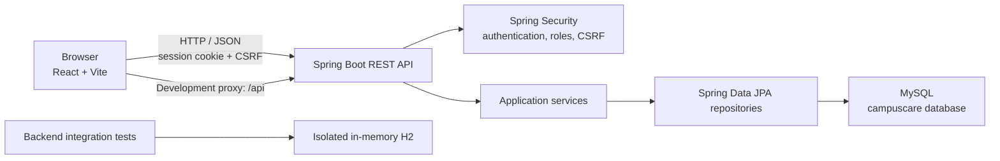

# CampusCare

**CampusCare – Campus Helpdesk and Maintenance Request System** is a web application for reporting and managing campus maintenance issues. Students can submit requests and follow their progress; administrators can review and manage requests through a role-protected workspace.

> This repository contains a React/Vite frontend and a Spring Boot REST API. The backend connects to MySQL. Use the existing backend setup guide for additional API and Postman details: [backend/README.md](backend/README.md).

## Problem statement

Campus maintenance issues can be difficult to report, route to the right team, and track through resolution. CampusCare provides a central workflow for reporting issues such as broken equipment, plumbing, lighting, furniture, and cleanliness concerns.

## Objectives

- Provide students with a clear way to submit and track maintenance requests.
- Give facilities administrators a campus-wide view of reported issues.
- Support request categorization, prioritization, status updates, assignment, and status history.
- Protect administrative operations with authenticated, role-based access.

## Features

### Students

- Register and sign in using a session-based account.
- Submit a maintenance request with a title, category, location, description, and priority.
- View and filter their own requests.
- Open request details and view status history.
- View request summary information on the dashboard.

### Administrators

- Sign in with an administrator account provisioned outside public student registration.
- View, search, and filter campus requests.
- Update request status and assign a request to an active administrator.
- View request details and status history.
- Soft-delete a request.
- View request summary information.

## Technology stack

| Area | Technologies |
|---|---|
| Frontend | React 18, JavaScript, Vite, CSS, Lucide React |
| Backend | Java 17, Spring Boot 3, Spring Web, Spring Data JPA, Bean Validation, Spring Security |
| Database | MySQL |
| Backend tests | JUnit/Spring Boot Test, Spring Security Test, H2 |
| Build tools | npm, Maven Wrapper |

## System architecture



In development, Vite proxies `/api` requests to `http://localhost:8080`. Browser authentication uses the backend session cookie; the frontend includes credentials and handles CSRF tokens for state-changing requests.

## Database entities and relationships

The backend maps these four tables:

| Entity / table | Purpose and relationships |
|---|---|
| `User` / `users` | Student and administrator accounts. A user can submit many maintenance requests, be assigned many requests as an admin, and author many status-history entries. |
| `RequestCategory` / `request_categories` | Request categories. A category can be referenced by many maintenance requests. |
| `MaintenanceRequest` / `maintenance_requests` | A request belongs to one submitting user and one category. It can optionally be assigned to an administrator and has status-history entries. |
| `RequestStatusHistory` / `request_status_history` | Records a request's status change, the user who made the change, timestamp, and optional note. Each entry belongs to one request and one user. |

Production Hibernate configuration is `ddl-auto=validate`: it checks the schema but does not create, update, or delete tables. With the `prod` Spring profile enabled, Flyway creates the schema on an empty MySQL database from the versioned migration. A non-empty database without Flyway history is baselined at version 1 and then checked by Hibernate validation; inspect an existing database before enabling this profile. Category initialization inserts missing names without replacing existing entries.

## Project structure

```text
CampusCare/
├── backend/
│   ├── src/main/java/com/campuscare/
│   │   ├── config/        # Security, CORS, category/admin initialization
│   │   ├── controller/    # REST endpoints
│   │   ├── dto/           # API request and response models
│   │   ├── entity/        # JPA entities and enums
│   │   ├── exception/     # API error handling
│   │   ├── repository/    # Spring Data repositories
│   │   └── service/       # Application logic
│   ├── src/test/          # H2-backed integration tests
│   ├── mvnw.cmd
│   ├── pom.xml
│   └── README.md          # Backend setup and API examples
├── src/
│   ├── components/        # Shared React UI
│   ├── data/              # Frontend data fixtures
│   ├── pages/             # Dashboard and workflow pages
│   ├── services/          # Centralized API client
│   ├── styles/            # Global and dashboard styles
│   ├── App.jsx
│   └── main.jsx
├── .env.example           # Frontend API base URL example
├── .gitignore
├── package.json
├── package-lock.json
└── vite.config.js
```

## Prerequisites

- Windows 10/11 with PowerShell.
- Java 17 or newer available on `PATH`.
- Node.js and npm.
- MySQL Server and a MySQL account with access to the `campuscare` database.

The Maven Wrapper downloads and runs the Maven version configured by the project.

## Windows setup

Open PowerShell in the project root:

```powershell
Set-Location "C:\path\to\CampusCare"
```

Install frontend dependencies:

```powershell
npm install
```

### 1. Prepare MySQL

Start MySQL, then create the database if it does not already exist:

```sql
CREATE DATABASE campuscare;
```

For local development with the default profile, use a database whose tables match the JPA entities. In production, activate the `prod` profile to let Flyway create the four tables on an empty database. The production migration also seeds the six initial categories. Do not change Hibernate to `create`, `create-drop`, or `update` as a workaround.

The application adds missing request categories at startup. Existing category entries are retained.

### 2. Configure backend environment variables

Set the connection settings in the same PowerShell window that will run the backend. Replace the username and enter your own password when prompted; do not commit credentials:

```powershell
$env:DB_URL = "jdbc:mysql://localhost:3306/campuscare?useSSL=false&allowPublicKeyRetrieval=true&serverTimezone=UTC"
$env:DB_USERNAME = "your-mysql-username"
$secureDbPassword = Read-Host "MySQL password" -AsSecureString
$env:DB_PASSWORD = [System.Net.NetworkCredential]::new("", $secureDbPassword).Password
```

Optional: provision a new administrator during application startup. Use an email not already assigned to a student account. The password must have at least 12 characters. If the configured email already belongs to a non-admin account, startup fails; the bootstrap process does not promote students.

```powershell
$env:BOOTSTRAP_ADMIN_EMAIL = "administrator@your-college.edu"
$env:BOOTSTRAP_ADMIN_NAME = "CampusCare Administrator"
$secureAdminPassword = Read-Host "New admin password (at least 12 characters)" -AsSecureString
$env:BOOTSTRAP_ADMIN_PASSWORD = [System.Net.NetworkCredential]::new("", $secureAdminPassword).Password
```

These variables apply to the current PowerShell session. The backend encodes the administrator password before storing it.

### 3. Run the Spring Boot backend

In the configured PowerShell window:

```powershell
Set-Location "C:\path\to\CampusCare\backend"
.\mvnw.cmd spring-boot:run
```

The API listens on `http://localhost:8080` locally (or the value of `PORT` when provided). Keep this window open while using the frontend.

### 4. Configure and run the React frontend

The root [.env.example](.env.example) contains:

```dotenv
VITE_API_BASE_URL=/api/v1
```

The default value works with the Vite development proxy. To create a local frontend environment file, open a second PowerShell window in the project root and run:

```powershell
Copy-Item .env.example .env.local
```

Do not put MySQL or administrator credentials in `.env.local`; Vite variables are frontend configuration. The `.env.local` file is ignored by Git.

Start Vite:

```powershell
Set-Location "C:\path\to\CampusCare"
npm run dev
```

Open the local URL printed by Vite (by default, `http://localhost:5173`). Student and administrator accounts use the same sign-in page. Public registration creates student accounts only; administrators must be provisioned through the backend bootstrap configuration or an existing administrative database process.

## Environment variables

| Variable | Used by | Description |
|---|---|---|
| `DB_URL` | Backend | JDBC URL for the MySQL database. Defaults to a local `campuscare` JDBC URL. |
| `DB_USERNAME` | Backend | MySQL username; required. |
| `DB_PASSWORD` | Backend | MySQL password; required. |
| `PORT` | Backend | Railway-provided HTTP port; takes precedence when present. |
| `SERVER_PORT` | Backend | Optional local server port fallback; defaults to `8080`. |
| `SPRING_PROFILES_ACTIVE` | Backend | Set to `prod` for Railway production settings and Flyway migrations. |
| `CORS_ALLOWED_ORIGIN` | Backend | Exact Vercel frontend origin, such as `https://campuscare.vercel.app`; no path or wildcard. Required with the `prod` profile. |
| `BOOTSTRAP_ADMIN_EMAIL` | Backend | Optional email for creating an admin account if it does not exist. |
| `BOOTSTRAP_ADMIN_NAME` | Backend | Optional bootstrap admin display name; defaults to `CampusCare Admin`. |
| `BOOTSTRAP_ADMIN_PASSWORD` | Backend | Required when bootstrap email is set; minimum 12 characters. |
| `VITE_API_BASE_URL` | Frontend | API base path; `.env.example` sets `/api/v1`. |

Keep actual secrets in local environment variables or a suitable secret manager. Never commit them.

## Railway and Vercel deployment

The backend service should use `backend/` as its service root and the Railway MySQL service as its database. Configure these variables on the Railway **backend service**:

```text
SPRING_PROFILES_ACTIVE=prod
DB_URL=jdbc:mysql://<railway-mysql-host>:<railway-mysql-port>/<railway-database>?serverTimezone=UTC
DB_USERNAME=<railway-mysql-username>
DB_PASSWORD=<railway-mysql-password>
CORS_ALLOWED_ORIGIN=https://<your-vercel-production-domain>
```

Use the connection host/port/database and credentials provided by Railway. Prefer Railway's private service connection where available. Do not copy real values into this README or source control. Railway provides `PORT`; the Spring Boot server binds to it automatically.

If provisioning an admin at startup, also set `BOOTSTRAP_ADMIN_EMAIL`, `BOOTSTRAP_ADMIN_NAME`, and `BOOTSTRAP_ADMIN_PASSWORD` in Railway. The admin password must have at least 12 characters. Do not leave a bootstrap password configured after provisioning unless you intend to keep that mechanism active.

For Vercel, configure the project root as the repository root, build command as `npm run build`, and output directory as `dist`. Set this **frontend build-time** variable in Vercel:

```text
VITE_API_BASE_URL=https://<your-railway-backend-domain>/api/v1
```

The Vercel origin configured in `CORS_ALLOWED_ORIGIN` must exactly match the deployed frontend origin, including `https://` and excluding any path. If using a custom frontend domain, configure that exact origin instead (or explicitly allow both trusted production origins in the Railway variable).

The production Spring profile enables Secure, `SameSite=None` session and CSRF cookies and credentialed CORS. Some browsers restrict third-party cookies across unrelated `vercel.app` and Railway domains even with these attributes. If sessions do not persist in a target browser, use custom domains under the same registrable domain or a same-origin reverse proxy.

### Database migration behavior

- An empty production database receives the `V1` schema migration and initial categories.
- A non-empty schema without Flyway history is automatically baselined at version 1 so the initial migration is not run over existing tables. Hibernate then validates the entity mappings.
- Back up and inspect an existing database before the first production-profile startup. A partially created or incompatible schema will fail validation; Flyway will not repair or delete it.
- The production migration is included and reviewed with the source, but deployment against Railway MySQL must still be verified in Railway logs. H2 tests do not prove MySQL migration compatibility.

## API overview

All API routes use the `/api/v1` prefix. See [backend/README.md](backend/README.md) for request/response examples, CSRF details, and validation responses.

| Method | Endpoint | Access |
|---|---|---|
| `GET` | `/auth/csrf` | Public; obtains CSRF token |
| `POST` | `/auth/register` | Public; always creates a student |
| `POST` | `/auth/login` | Public |
| `POST` | `/auth/logout` | Authenticated |
| `GET` | `/auth/me` | Authenticated current user |
| `GET` | `/request-categories` | Public |
| `POST` | `/requests` | Student |
| `GET` | `/requests/mine` | Student |
| `GET` | `/requests/recent` | Authenticated; scope depends on role |
| `GET` | `/requests/{publicId}` | Request owner or admin |
| `GET` | `/requests/{publicId}/history` | Request owner or admin |
| `GET` | `/dashboard/student/summary` | Student |
| `GET` | `/dashboard/admin/summary` | Admin |
| `GET` | `/admin/requests` | Admin |
| `PATCH` | `/admin/requests/{publicId}/status` | Admin |
| `PATCH` | `/admin/requests/{publicId}/assignment` | Admin |
| `DELETE` | `/admin/requests/{publicId}` | Admin; soft delete |

State-changing requests require CSRF protection. Session authentication uses a server-side session cookie. Students cannot access admin endpoints; the API enforces authorization independently of frontend navigation.

## Testing and production build

Run backend tests from the `backend` directory. They use an isolated in-memory H2 database and do not require or modify MySQL:

```powershell
Set-Location "C:\path\to\CampusCare\backend"
.\mvnw.cmd clean verify
```

Build the frontend production bundle from the project root:

```powershell
Set-Location "C:\path\to\CampusCare"
npm run build
```

The generated frontend files are placed in `dist/`.

## Screenshots

Add current project screenshots to this section before publishing. Suggested views:

- Student dashboard
- Submit request form
- My requests and request history
- Administrator dashboard

<!-- Example after adding screenshot files:


-->

## Future enhancements

Possible future work (not included as current functionality):

- Email or push notifications when request status changes.
- Password reset and account self-service.
- Reporting and analytics for facilities teams.
- Deployment configuration and production hosting.
- Accessibility and usability review with campus users.

## Author and institution

- **Author:** [Add your name]
- **Institution:** [Add your college or university]
- **Department / course:** [Add department or course, if applicable]

Replace these placeholders with the correct details before submitting or publishing the repository.
